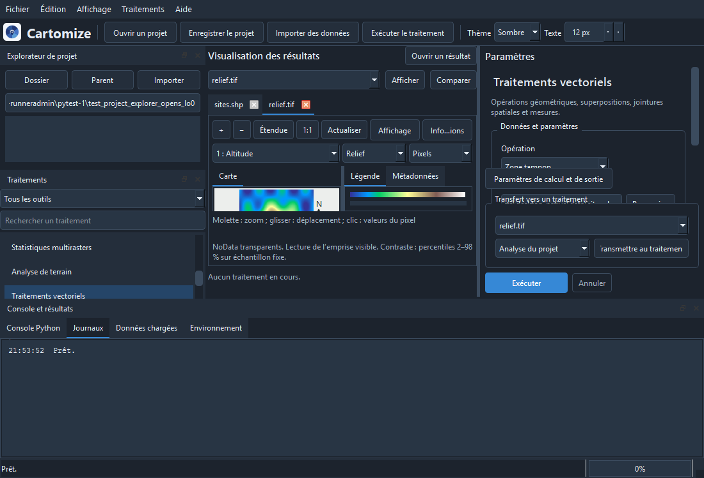
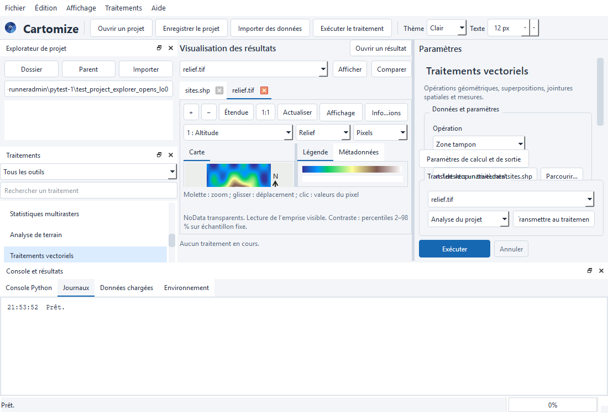

# Cartomize 1.1.0 : validation exécutée

Code testé : `290773ecaa82a795608782cd9f654344a16885c1`

[Exécution GitHub Actions](https://github.com/cedrick14/cartomize-python/actions/runs/39503435509)

| Environnement | Tests réussis | Tests spécialisés ignorés | Installation isolée |
|---|---:|---:|---|
| ubuntu-latest-py3.11 | 354 | 2 | Réussie |
| ubuntu-latest-py3.12 | 354 | 2 | Réussie |
| windows-latest-py3.11 | 354 | 2 | Réussie |
| windows-latest-py3.12 | 354 | 2 | Réussie |

Les images sont des captures de l’application exécutée, et non des maquettes. Les raisons des tests spécialisés ignorés figurent dans validation.json.

## Interface Windows

