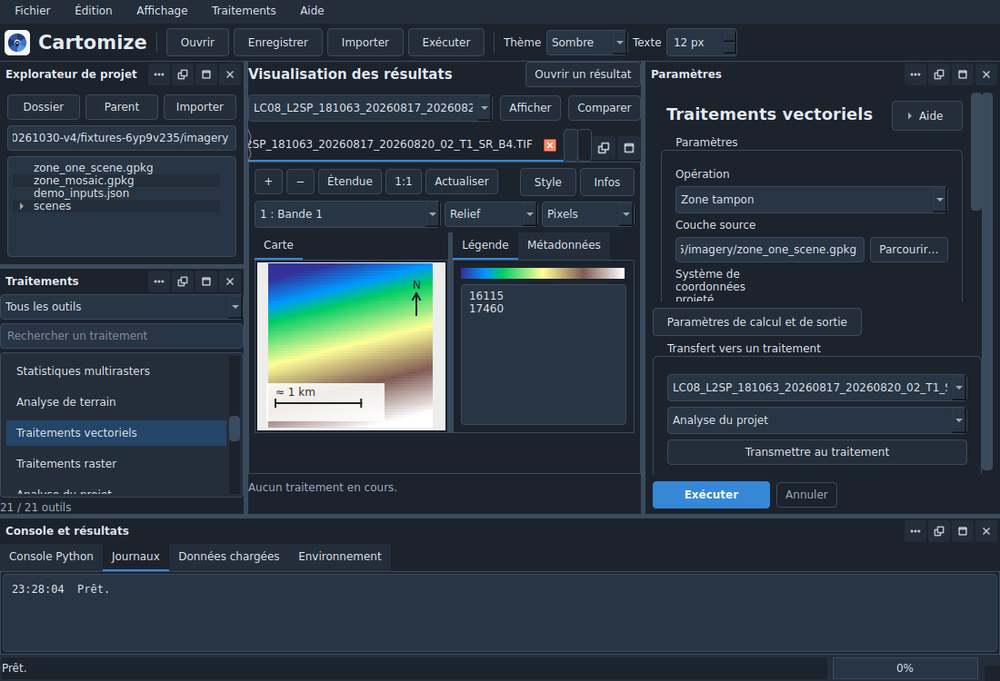
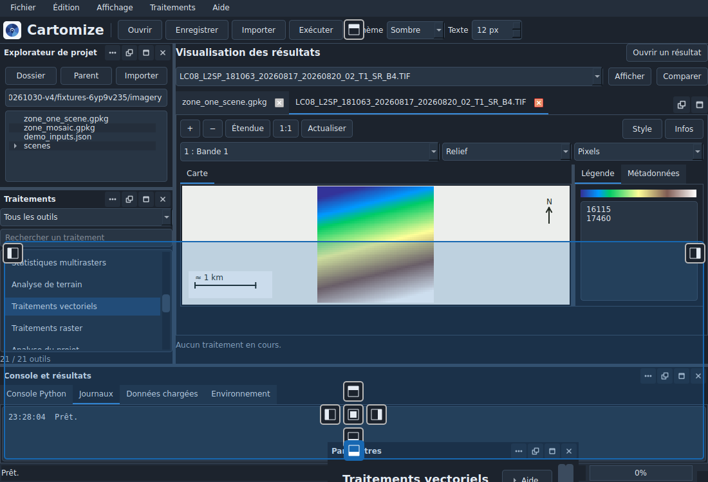

# Panneaux et vues mobiles — Cartomize 1.0

Guide de la construction **2026103001**. Le numéro public reste **1.0** ; l’état de distribution est suivi dans [PUBLICATION.md](PUBLICATION.md).

Capture de l’application sur les scènes pédagogiques synthétiques de la démonstration.
Le [thème clair](images/dynamic-workspace/light.png) conserve la même organisation.

## Repères de départ

La disposition initiale est conservée :

| Emplacement | Contenu |
|---|---|
| Gauche | Explorateur de projet et catalogue des traitements |
| Centre | Cartes, couches, tableaux, graphiques et rapports |
| Droite | Paramètres du traitement et commandes d’exécution |
| Bas | Console Python, journaux, données chargées et environnement |

Les panneaux peuvent être redimensionnés par leurs séparateurs. Déplacer un panneau ou une vue conserve son contenu et les valeurs du formulaire.

## Déplacer et regrouper

1. Saisir la **barre de titre** du panneau et commencer à la faire glisser.
2. Survoler l’emplacement souhaité. Les guides proposent **gauche, droite, haut et bas** ; le centre d’un autre panneau permet de les **regrouper en onglets**.
3. Relâcher sur le guide choisi. **Échap** annule le déplacement et retrouve le placement précédent.

Le bouton **Positionner** ouvre un menu pour choisir un côté sans glisser. **Grouper avec** permet de choisir directement un autre panneau.

Ce contrôle hors écran réunit les captures des véritables widgets Qt à leurs positions :
panneau déplacé, repères et aperçu de la destination. Le geste est exécuté avec
les événements de souris Qt ; les contrôles natifs Windows et Linux sont suivis
dans l’intégration continue.

Pour déplacer une vue encore dans les onglets centraux, ouvrir son menu et choisir **Détacher**. Sa barre de titre donne ensuite accès aux mêmes guides et commandes de placement. **Réintégrer dans les vues** la ramène aux onglets centraux.

## Commandes de la barre de titre

| Commande | Résultat |
|---|---|
| **Positionner** | Choisir un côté ou regrouper avec un autre panneau |
| **Détacher** | Ouvrir le panneau dans une fenêtre indépendante |
| **Ancrer** | Ramener une fenêtre détachée dans l’espace de travail |
| **Agrandir** | Donner temporairement davantage d’espace au panneau ou à la vue |
| **Rétablir** | Revenir de l’agrandissement au placement précédent |
| **Fermer** | Retirer le panneau ou la vue de l’affichage |
| **Réintégrer dans les vues** | Ramener une vue de résultat aux onglets centraux |

Le menu **Affichage** rouvre les panneaux de l’application. Une vue de résultat fermée peut être rouverte depuis les données chargées ou le catalogue des résultats ; son fichier reste disponible.

## Agrandir l’espace central et revenir au départ

**F11**, ou **Affichage > Agrandir la vue**, masque temporairement les panneaux autour de l’espace central. Appuyer de nouveau sur **F11** ou sur **Échap** retrouve leur visibilité et leur placement précédents. **Échap** permet aussi de quitter le mode agrandi d’un panneau ancré.

Pour repartir de l’organisation initiale, choisir **Affichage > Rétablir la disposition**. Cette commande réintègre les vues détachées, replace les panneaux et les rend visibles. Les données et les paramètres restent conservés.

## Aide et apparence

Les descriptions des **21 pages** et les explications longues sont repliées derrière **Aide**. Le bouton s’utilise à la souris ou avec **Tab**, puis **Espace**. Le texte complet reste consultable et sélectionnable.

Les valeurs saisies, unités, erreurs, diagnostics et avertissements opérationnels restent visibles : couverture partielle, contraintes du SCR, valeurs manquantes ou précision du traitement. Les thèmes **Clair**, **Sombre** et **Système** ainsi que la taille du texte de **11 à 16 pixels** sont conservés.

## Mémoriser le placement

Le placement des panneaux et les préférences d’apparence sont mémorisés localement entre les lancements.

**Enregistrer le projet** conserve en plus le placement des vues de résultats avec leurs réglages : onglet central ou panneau, côté d’ancrage, regroupement, position et taille de la fenêtre détachée. L’ouverture du projet restaure les vues disponibles et leur placement. Les sessions antérieures restent lisibles.

Voir le [guide général](WORKBENCH.md), les [fonctions des vues de résultats](RESULTS_WORKSPACE.md) et le [parcours de démonstration](DEMONSTRATION_1.0.md).
